<div align="center">

<picture>
  <source media="(prefers-color-scheme: dark)" srcset="assets/banner.svg">
  <source media="(prefers-color-scheme: light)" srcset="assets/banner-light.svg">
  
</picture>

[](LICENSE)
[](#instalación)
[](#instalación)
[](#instalación)
[](https://uniqai.app/?utm_source=github&utm_medium=readme-es&utm_campaign=suno-producer)

**Prompts para Suno, metaetiquetas y estructura de la letra que el modelo sigue de verdad, en inglés y en ruso.**

[Inicio rápido](#inicio-rápido) · [Cómo funciona](#cómo-funciona) · [Reglas del lint](#reglas-del-lint) · [Ejemplos](#ejemplos) · [Instalación](#instalación) · [FAQ](#faq)

</div>

[English](README.md) · [Русский](README.ru.md) · [简体中文](README.zh-CN.md) · Español · [Português (BR)](README.pt-BR.md) · [日本語](README.ja.md) · [한국어](README.ko.md)

# suno-producer: prompts para Suno, metaetiquetas y estructura de la letra

Prompts para Suno en tres partes: un **prompt de estilo** de una línea (género, BPM, tonalidad, ánimo, instrumentos, producción, voz), una **estructura por secciones** con metaetiquetas (`[Intro]`, `[Verse]`, `[Pre-Chorus]`, `[Chorus]`, `[Drop]`, `[Bridge]`, `[Outro]`) y una **letra** cuyos versos son lo bastante regulares como para que una voz generada los cante sin atropellarse, todo pensado para los campos Style y Lyrics del editor de Suno. La lista de etiquetas y los límites de cada campo se recopilaron con Suno v4.5 y posteriores (v5.5 es el modelo actual a fecha de 2026-10, según [la cobertura del lanzamiento de Suno en marzo de 2026](https://www.musicbusinessworldwide.com/suno-launches-v5-5-ai-model-with-voice-capture-and-personalization-features)); el editor muestra los límites vigentes y los presupuestos del lint son flags que puedes ajustar. Funciona como skill de Claude Code, como regla de Cursor o como fragmento de `AGENTS.md` para Codex, y los tres scripts sirven por sí solos como una simple lista de comprobación con lint. UniqAI hace herramientas de foto, video y chat, no de música; este es un proyecto paralelo que usamos nosotros mismos.

| **Entra un brief, sale un prompt** | **Métrica de la letra, EN + RU** | **Lint antes de gastar créditos** |
|:---|:---|:---|
| `brief.py` convierte "sad synthwave, female vocal" en un prompt de estilo, dos variantes A/B de un solo eje, una estructura etiquetada y objetivos de sílabas por sección. | `lyric_meter.py` cuenta las sílabas de cada verso, deduce el esquema de rima por sección y señala los versos que se alejan de la mediana de la sección. Heurísticas para inglés, conteo exacto de vocales para ruso. | `suno_lint.py` comprueba la ortografía y la colocación de las etiquetas, el orden de la estructura, la longitud de las secciones, los presupuestos de los campos y las frases de imitación de artistas. Ids de regla estables, código de salida 1 si hay errores. |

## Inicio rápido

```bash
git clone https://github.com/uniqaiapp/suno-producer
cd suno-producer
python3 scripts/brief.py --genre synthwave --fuse "indie pop" --mood melancholic --seed 7
python3 scripts/lyric_meter.py examples/lyrics/midnight-bus.txt
python3 scripts/suno_lint.py examples/lyrics/bad-tags.txt --style examples/style/bad-style.txt
```

El primer comando imprime un prompt de estilo con las variantes B y C, una estructura `[Intro] … [Outro]` y un brief para la letra. El segundo imprime las sílabas por verso y el esquema de rima de cada sección de la canción de ejemplo. El tercero falla con tres errores y nueve avisos, cada uno con su id de regla y su número de línea. Python 3.9+, sin paquetes que instalar.

## Demo



## Cómo funciona

1. **Brief.** `scripts/brief.py` lee `references/genres.json` (rango de tempo, tonalidades, instrumentos, palabras de producción y voz por defecto de cada género; valores editoriales, no mediciones) y monta un prompt de estilo separado por comas en el orden que el modelo pondera: género, fusión, tempo, tonalidad, dos palabras de ánimo, instrumentos, producción, voz, idioma. Con `--fuse` usa la intersección de los dos rangos de tempo. También elige la estructura de secciones del género e imprime los versos por sección y los presupuestos de sílabas.

2. **Variantes.** Cada variante cambia exactamente un descriptor (voz, producción, o tempo en torno a un 8 %), así que una escucha A/B te dice qué cambio importó. `tests/test_brief.py` comprueba esa diferencia de un solo descriptor. La salida es determinista para un `--seed` dado.

3. **Métrica.** `scripts/lyric_meter.py` divide la letra por etiqueta `[Section]`, cuenta sílabas (inglés: grupos de vocales con reglas para la e muda, -ed, -es y -le; ruso: una vocal, una sílaba), construye el esquema de rima a partir de las terminaciones de las palabras (mayúscula = rima consonante, minúscula = rima asonante) y avisa cuando un verso se aleja más de dos sílabas de la mediana de la sección. Los versos que son solo `(backing vocals)` quedan exentos.

4. **Lint.** `scripts/suno_lint.py` recorre la letra una vez e informa según la tabla de reglas de abajo; después revisa el prompt de estilo en busca de etiquetas, frases de artistas, número de líneas, tempo y presupuesto. `--json` para máquinas, `--strict` para fallar también con avisos.

5. **El skill** (`SKILL.md`) lo une todo para un agente: aclarar el brief, ejecutar `brief.py`, escribir la letra dentro de la estructura, pasar las dos comprobaciones, entregar Style + Lyrics + variantes en un formato fijo y, cuando el usuario vuelve con una generación mala, cambiar una sola cosa según `references/troubleshooting.md`.

```
description ──► brief.py ──► style prompt A/B/C + structure + lyric brief
                                   │
                              write lyrics
                                   │
                 lyric_meter.py ◄──┴──► suno_lint.py
                 syllables, scheme       tags, order, budgets, L001–L016
                                   │
                           Style + Lyrics + variants
```

## Reglas del lint

| Id | Nivel | Comprobación |
|---|---|---|
| L001 | warn | Etiqueta que no está en la lista conocida (`references/section-tags.md`); el modelo podría cantarla |
| L002 | warn | Letra antes de la primera etiqueta, o sin etiquetas |
| L003 | warn | No hay `[Chorus]`, `[Hook]` ni `[Drop]` (se omite con `--instrumental`) |
| L004 | warn | La misma etiqueta dos veces seguidas |
| L005 | warn | `[Intro]` no va primero o `[Outro]` no va al final |
| L006 | error / warn | `[ ]` sin cerrar (error) o `( )` sin cerrar (warn) en una línea |
| L007 | error | Frase de imitación de artista ("in the style of", "sounds like", "в стиле", "как у") en la letra o en el estilo |
| L008 | error / warn | Prompt de estilo por encima del presupuesto (`--max-style`, 1000 por defecto) / vacío |
| L009 | error | Letra por encima del presupuesto (`--max-lyrics`, 5000 por defecto) |
| L010 | warn | Una etiqueta dentro de un verso |
| L011 | warn | Sección más larga que `--max-section-lines` (12 por defecto) |
| L012 | warn | `[Tags]` en el prompt de estilo |
| L013 | warn | Prompt de estilo repartido en más de tres líneas |
| L014 | warn | Etiqueta en minúsculas |
| L015 | info | Sin tempo en el prompt de estilo |
| L016 | warn | Una sección de letra sin versos (las etiquetas instrumentales quedan exentas) |

Los presupuestos son valores por defecto, no una especificación; el editor de Suno muestra el límite vigente junto a cada campo.

## Ejemplos

Cada salida de abajo está guardada en `examples/outputs/` y `python3 tests/run.py` la reproduce byte a byte; `examples/README.md` lista los comandos.

<details>
<summary><b>Informe de métrica de una canción en inglés (synthwave / indie pop)</b></summary>

Entrada: `examples/lyrics/midnight-bus.txt`. Comando: `python3 scripts/lyric_meter.py examples/lyrics/midnight-bus.txt`.

```text
[Verse 1]      4 lines · syllables 6-8 · scheme ABAB
   1   6  Streetlights hum a tired song                A
   2   7  Rain keeps tapping on the glass              B
   3   8  Every stop takes twice as long               A
   4   7  Watching all the faces pass                  B
[Pre-Chorus]   2 lines · syllables 8-9 · scheme AA
   1   8  I count the stops, I count the miles         A
   2   9  I keep your seat warm for a while            A
[Chorus]       4 lines · syllables 6-9 · scheme AABB
   1   6  Midnight bus, take me home                   A
   2   7  Through a city made of chrome                A
   3   9  Every window's a telephone                   B
   4   7  Ringing nowhere, ringing on                  B
```

Informe completo: `examples/outputs/midnight-bus.meter.txt`. La canción pasa el lint sin incidencias con su prompt de estilo `examples/style/midnight-bus.txt`.

</details>

<details>
<summary><b>Informe de métrica de una canción en ruso (balada rock)</b></summary>

Entrada: `examples/lyrics/severny-veter.ru.txt`. Comando: `python3 scripts/lyric_meter.py examples/lyrics/severny-veter.ru.txt`.

```text
[Verse 1]      4 lines · syllables 10 · scheme AABB
   1  10  Северный ветер стучится в окно               A
   2  10  Чай на столе остывает давно                  A
   3  10  Я не ответил на тысячу слов                  B
   4  10  Город молчит, и молчать я готов              B
[Chorus]       4 lines · syllables 8 · scheme ABAB
   1   8  Не уходи, пока горит                         A
   2   8  Последний свет в моём окне                   B
   3   8  Пусть этот город говорит                     A
   4   8  О ком-то, но не обо мне                      B
```

Aquí todas las rimas son consonantes según la regla de terminaciones del script. Para una rima asonante, mira la estrofa 2 de la canción en inglés de arriba: `scheme ABaB`, donde la `a` minúscula marca `door` / `for` como coincidencia solo en la terminación. Particularidades del ruso: `references/russian-vocals.md`.

</details>

<details>
<summary><b>Lint sobre un archivo roto a propósito</b></summary>

Comando: `python3 scripts/suno_lint.py examples/lyrics/bad-tags.txt --style examples/style/bad-style.txt` (código de salida 1).

```text
! L002  lyrics before the first section tag; Suno treats untagged text as a verse
x L007  artist-imitation phrase in style prompt ("sounds like"); describe the sound instead
! L012  style prompt contains [tags]; tags belong in the lyrics field
! L014  line 2: tag [intro] is lower-case; write tags Capitalised for consistency
x L007  line 4: artist-imitation phrase in lyrics ("sound like"); Suno rejects named artists
! L016  line 5: section [Verse 1] has no lines
! L001  line 6: unknown tag [Guitar Shred]; Suno may sing it instead of following it
x L006  line 7: unbalanced square brackets
! L010  line 9: tag inside a lyric line; put each tag on its own line
! L011  line 10: [Chorus] has 13 lines (limit 12); long sections tend to get rushed or cut
! L005  line 24: [Outro] is not the last tag
= 3 error(s), 9 warning(s), 1 info
```

</details>

<details>
<summary><b>Brief con variantes de un solo eje</b></summary>

Comando: `python3 scripts/brief.py --genre synthwave --fuse "indie pop" --mood melancholic --seed 7`.

```text
Style prompt (paste into the Style field)
  A  [base] synthwave, indie pop, 108 BPM, C minor, melancholic, wistful, gated reverb drums, retro drum machine, jangly electric guitar, 80s production, lo-fi warmth, warm female vocal
  B  [vocal] … 80s production, lo-fi warmth, breathy female vocal
  C  [production] … jangly electric guitar, wide stereo pads, lo-fi warmth, warm female vocal

Structure (pop)
  [Intro] [Verse 1] [Pre-Chorus] [Chorus] [Verse 2] [Pre-Chorus] [Chorus] [Bridge] [Chorus] [Outro]
```

Salida completa (B y C sin abreviar, más el brief de la letra): `examples/outputs/brief-synthwave-indie-pop.txt`. Variante en ruso: `examples/outputs/brief-russian-rock.ru.txt`.

</details>

## Instalación

Funciona con cualquier agente que lea archivos de instrucciones. Elige el tuyo. Requisitos: Python 3.9+. Sin paquetes que instalar.

<details open>
<summary><b>Claude Code</b></summary>

```bash
# global
git clone https://github.com/uniqaiapp/suno-producer ~/.claude/skills/suno-producer
# or project-local
git clone https://github.com/uniqaiapp/suno-producer .claude/skills/suno-producer
# or via the skills CLI
npx skills add uniqaiapp/suno-producer
```

Después escribe `/suno-producer` en cualquier sesión, o simplemente describe la canción; la `description` del skill lo activa. Como plugin, cuando se publique el marketplace de uniqaiapp: `/plugin marketplace add uniqaiapp/skills` y después `/plugin install suno-producer@uniqaiapp`.

</details>

<details>
<summary><b>Cursor</b></summary>

Copia `SKILL.md`, `scripts/`, `references/` y [`.cursor/rules/suno-producer.mdc`](.cursor/rules/suno-producer.mdc) a tu proyecto. El archivo de regla incrusta el skill.

</details>

<details>
<summary><b>Codex / cualquier agente con AGENTS.md</b></summary>

Copia `SKILL.md`, `scripts/` y `references/` a `.agents/skills/suno-producer/` y añade el fragmento de [`codex/INSTRUCTIONS.md`](codex/INSTRUCTIONS.md) a tu `AGENTS.md`.

</details>

<details>
<summary><b>Prompt plano, o sin agente</b></summary>

Pega [`SKILL.md`](SKILL.md) en el system prompt de cualquier modelo; no tiene sintaxis específica de ningún agente fuera del frontmatter. Cada script funciona por sí solo: `python3 scripts/<name>.py --help`.

</details>

## Límites y honestidad

- Los conteos de sílabas son heurísticos para inglés (normalmente con un margen de una sílaba respecto a un diccionario; "fire", "idea", "every" son fallos típicos) y conteos exactos de vocales para ruso. La detección de rima compara terminaciones y no sabe nada de acentuación.
- Los scripts nunca llaman a Suno. Eliminan las causas conocidas de las generaciones malas; no pueden prometer una buena.
- Cada número de este README (conteos de sílabas, número de reglas, `3 error(s), 9 warning(s)`) es la salida de un script de este repositorio sobre un archivo de este repositorio, reproducida por los tests. Los rangos de tempo de la tabla de géneros son valores editoriales, no mediciones, y el propio archivo lo dice.
- Sin afiliación con Suno. No se incluyen letras con derechos de autor ni deben pedirse; el lint rechaza "in the style of" un artista.

## Relacionados

- [video-director](https://github.com/uniqaiapp/video-director): convierte una idea de una línea en un prompt plano a plano para modelos de video con IA (Kling, Veo, Sora y otros), con vocabulario de cámara, iluminación y movimiento.
- [deslop-ru](https://github.com/uniqaiapp/deslop-ru): elimina el relleno con sabor a IA de textos en ruso: un skill más un script de biblioteca estándar que señala y reescribe las muletillas habituales.
- [token-diet](https://github.com/uniqaiapp/token-diet): recorta tokens de prompt y de contexto sin perder significado: reglas medibles, un estimador de biblioteca estándar y ejemplos de antes y después.

## FAQ

<details>
<summary><b>¿Por qué Suno canta la palabra "Chorus"?</b></summary>

La etiqueta no se reconoció como estructura: estaba mal escrita, en minúsculas o en la misma línea que la letra. Pon una etiqueta conocida de `references/section-tags.md` en su propia línea y con mayúscula inicial. `suno_lint.py` señala los tres casos (L001, L010, L014).

</details>

<details>
<summary><b>¿Puedo pedir una canción al estilo de un artista concreto?</b></summary>

No; Suno rechaza los nombres de artistas y el resultado sería una imitación. Traduce lo que oyes a palabras de sonido (época, instrumentos, producción, voz). `references/style-prompts.md` tiene una tabla y el lint señala esas frases (L007).

</details>

<details>
<summary><b>¿Funciona con letras en ruso?</b></summary>

Sí. El conteo de sílabas es exacto para ruso (una vocal, una sílaba), la regla de rima maneja terminaciones abiertas y cerradas, y `brief.py --lang ru` añade `Russian-language vocals, clear diction` al prompt de estilo y cambia el brief de la letra a los presupuestos para ruso. `references/russian-vocals.md` está en ruso.

</details>

<details>
<summary><b>¿De dónde salen los límites de caracteres?</b></summary>

Son valores por defecto de `suno_lint.py` (`--max-style 1000`, `--max-lyrics 5000`), elegidos para ir sobre seguro. El editor de Suno muestra el límite actual junto a cada campo; pasa el flag si el tuyo es distinto.

</details>

<details>
<summary><b>¿Esto genera música?</b></summary>

No. Escribe las entradas (prompt de estilo, estructura, letra) y las comprueba. Tú las pegas en Suno. UniqAI tampoco genera música.

</details>

## Contribuir

Los issues y pull requests son bienvenidos. Haz cambios pequeños e incluye un ejemplo de antes y después en la descripción del PR. Consulta [CONTRIBUTING.md](CONTRIBUTING.md) para las comprobaciones locales (`python3 tests/run.py`, sin dependencias).

## Licencia

Código y skill: [MIT](LICENSE) © UniqAI. Las bibliotecas de prompts en `references/` son CC BY 4.0 (atribución: UniqAI, https://github.com/uniqaiapp/suno-producer); el archivo [LICENSE](LICENSE) indica qué rutas quedan bajo cada licencia.

---

<div align="center">

<sub>Hecho por <a href="https://uniqai.app/?utm_source=github&utm_medium=readme-es&utm_campaign=suno-producer">UniqAI</a> — Kling 3.0, Veo 3, Flux, Nano Banana y GPT-5/Claude/Gemini/Grok en una sola app.</sub>

</div>
